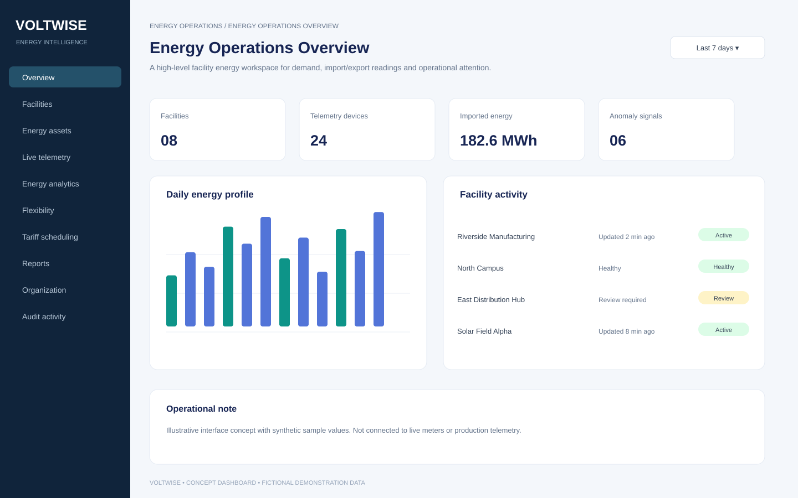
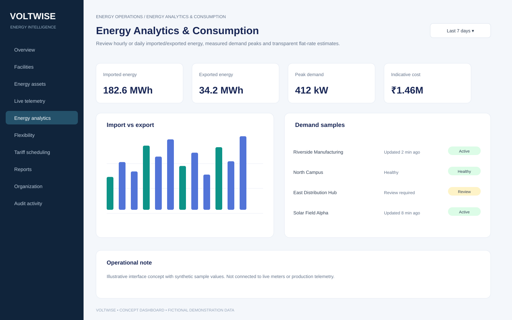
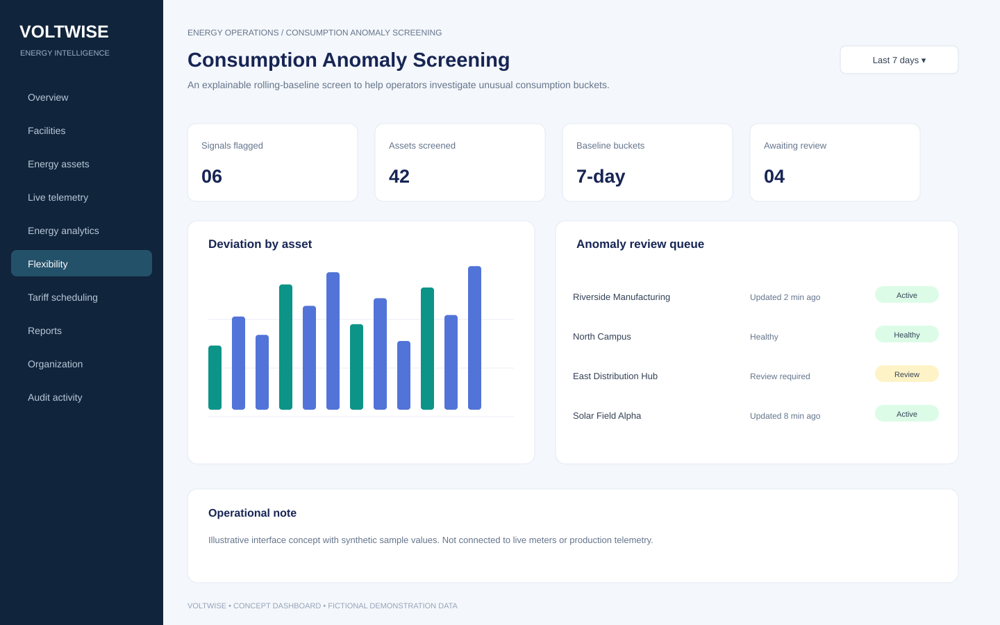
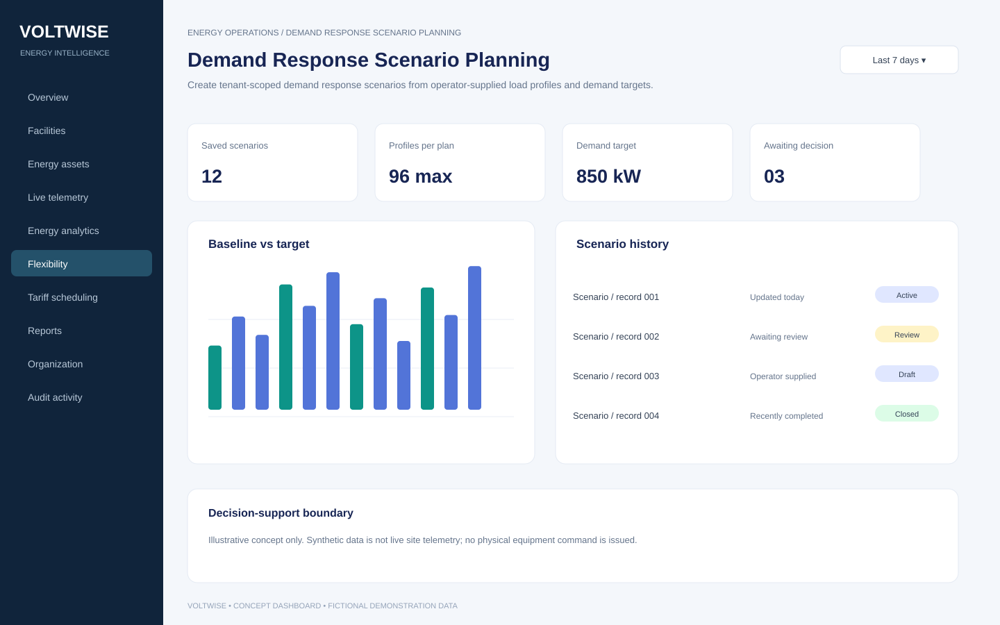
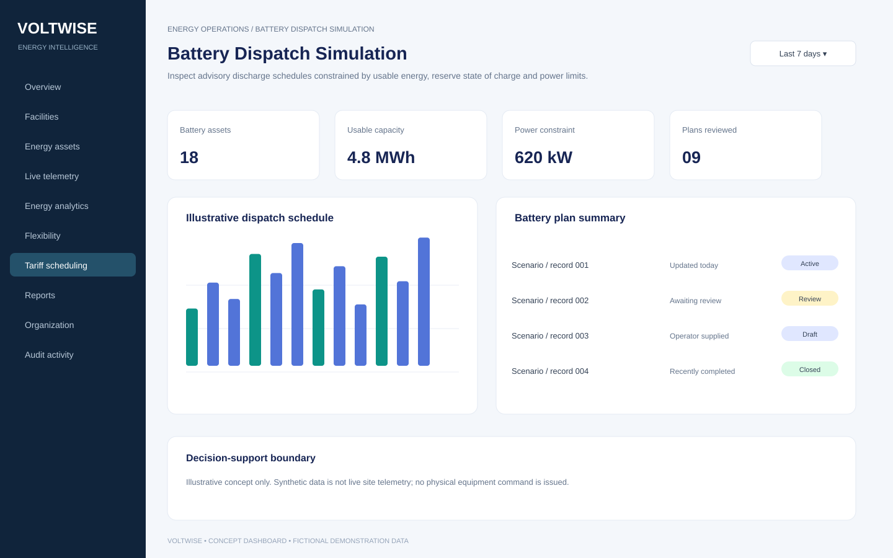
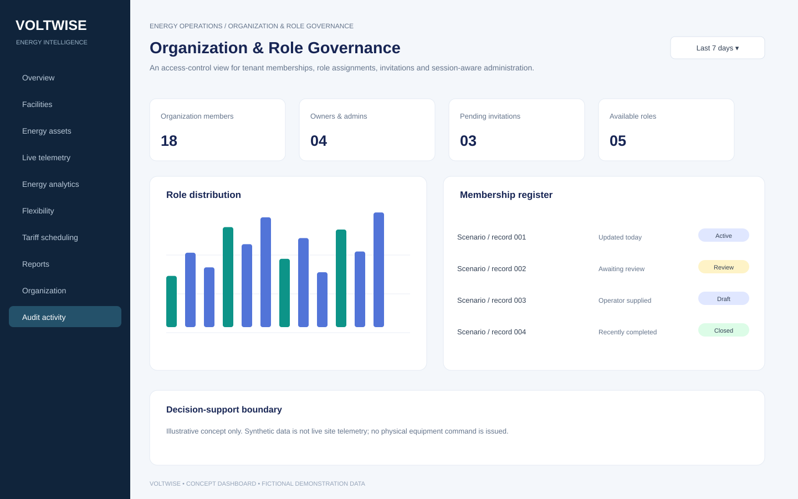

# Voltwise ⚡

**AI-Powered Energy Intelligence & Grid Flexibility Platform**

Voltwise is a multi-tenant energy operations and decision-support platform for organizations that need to understand electricity demand, coordinate distributed energy assets, inspect telemetry, and evaluate flexibility scenarios. It brings facility and asset registries, device ingestion, energy analytics, demand-response simulation and tariff-aware battery scheduling into one auditable workspace.

> **Project status:** Portfolio software prototype. Identity and organization management, facility and asset registry, device telemetry ingestion, energy analytics, demand-response simulation and time-of-use battery scheduling are implemented in the current main-branch roadmap. The product overview includes demonstration metrics; the local device simulator generates synthetic readings, not physical meter data. This is not a certified energy management, grid-control or safety system.

## Who it is for

- **Energy and facility managers** monitoring consumption across sites and equipment.
- **Operations teams** provisioning devices and reviewing incoming meter telemetry.
- **Sustainability and energy analysts** examining import/export trends and indicative energy costs.
- **Energy programme operators** modeling demand-response scenarios and battery schedules.
- **Organization administrators and auditors** managing access, tenant membership and recorded activity.

## The problem Voltwise addresses

Energy data is often fragmented across facilities, meters, equipment vendors and operational spreadsheets. Voltwise provides a common tenant-scoped workspace to register facilities and assets, ingest validated readings, aggregate energy measurements and test operational flexibility assumptions. Its intelligence is advisory: users review assumptions and approve proposals; the platform does not autonomously control physical equipment.

## Illustrative dashboard gallery

The following twelve original interface concepts represent the platform's key workspaces. They are displayed in a single column for clear viewing. Every chart, number, site name, device status and activity record is synthetic demonstration data.

### 1. Energy Operations Overview

A high-level portfolio snapshot of facility coverage, device activity, energy totals and operational signals for an energy operations team.

<p align="center"></p>

### 2. Facility & Site Portfolio

A facility management concept for navigating site hierarchies, facility types, lifecycle state and site-level operational context.

<p align="center"></p>

### 3. Energy Asset Registry

A structured equipment inventory concept covering meters, solar PV, inverters, batteries, EV chargers, HVAC, generators and other registered assets.

<p align="center"></p>

### 4. Live Device Telemetry

A device operations concept for provisioning, revoking credentials and observing validated incoming measurements and device activity.

<p align="center"></p>

### 5. Energy Analytics & Consumption

A transparent analytics view of imported and exported energy, measured demand samples, date filters and optional flat-rate cost estimates.

<p align="center"></p>

### 6. Consumption Anomaly Screening

An explainable baseline-screening concept that helps analysts identify unusual consumption buckets for investigation; signals are not fault diagnoses.

<p align="center"></p>

### 7. Demand Response Scenario Planning

A scenario workspace for operator-provided load profiles, demand targets, battery assumptions and tenant-scoped planning history.

<p align="center"></p>

### 8. Battery Dispatch Simulation

An advisory simulation concept showing recommended discharge intervals subject to usable energy, reserve state-of-charge assumptions and power limits.

<p align="center"></p>

### 9. Time-of-Use Tariff Scheduling

A deterministic tariff-aware scheduling concept based on operator-supplied INR/kWh rates and configurable battery operating assumptions.

<p align="center"></p>

### 10. Optimization Proposal Governance

A human review workspace for approving or rejecting simulation proposals with notes and recorded decision history.

<p align="center"></p>

### 11. Organization & Role Governance

An organization administration concept for membership roles, invitations and tenant-aware access management.

<p align="center"></p>

### 12. Tenant Audit & Operational Traceability

An audit overview concept for reviewing organization-scoped security and workflow activity while keeping secrets and token values out of audit metadata.

<p align="center"></p>

> **Illustration disclaimer:** These are original SVG mockups, not captured screenshots of the running application. All figures and records are fictional. They do not prove a particular feature's runtime state, live integration or operational performance. See the implementation and roadmap sections below for verified scope.

## Implemented capabilities

The following scope is checked off in the current [delivery roadmap](docs/roadmap.md) and supported by the source and domain documentation.

| Domain | Current implementation |
|---|---|
| Identity & tenancy | User registration/login, bcrypt password hashing, short-lived JWT access tokens, rotating opaque refresh sessions, organization memberships, tenant switching and server-side RBAC |
| Organization governance | Tenant-scoped member administration, invitations with hashed one-time tokens, audit event records and organization context validation |
| Facility registry | Tenant-scoped facility hierarchy, metadata, lifecycle state, paginated search and parent-cycle validation |
| Energy asset registry | Tenant-scoped meters, solar PV, inverters, batteries, EV chargers, HVAC, generators, transformers and equipment; asset/facility ownership checks and soft decommissioning |
| Device provisioning | Tenant-bound devices, one-time 256-bit device credentials, hash-at-rest storage and credential revocation |
| Telemetry ingestion | Authenticated HTTP ingestion and optional MQTT subscriber; strict metric/unit validation, timestamp bounds, idempotent event persistence and tenant-scoped reading history |
| Real-time updates | Authenticated Server-Sent Events stream; initial fan-out is process-local |
| Energy analytics | Tenant-scoped hourly/daily import/export aggregation, sampled demand metrics, optional flat-rate cost estimates, heuristic anomaly screening and CSV export |
| Flexibility simulation | Demand-response scenarios, battery discharge simulation with power/energy/reserve constraints, saved plans and approval/rejection history |
| Tariff optimization | Deterministic time-of-use battery scheduling heuristic using operator-provided tariff intervals, SoC, power and efficiency assumptions |

### Important implementation boundaries

- The dashboard overview still includes clearly marked demonstration metrics. The simulator's readings are synthetic.
- Telemetry is persisted directly to MongoDB and streamed through process-local SSE fan-out. Durable queue buffering, backpressure, dead-letter handling, replay and retention automation remain future hardening work.
- MQTT is an optional adapter. Production use requires TLS, strict broker ACLs and credential management.
- Energy analytics uses UTC buckets. Demand values are measured samples, not interval-integrated demand. Optional cost estimates use a caller-supplied flat tariff; they are not utility bills.
- Anomaly flags are heuristic screening signals, not fault diagnoses or predictive maintenance.
- Flexibility plans and tariff schedules are simulations. Approval is an internal workflow decision; no battery, inverter, meter, BMS or aggregator command is sent.
- No operational AI forecasting engine, AI assistant, emissions calculation engine or predictive maintenance workflow is currently claimed as implemented.

## Architecture

Voltwise is a TypeScript npm-workspaces monorepo with a React single-page client and an Express API. The server is authoritative for authentication, authorization, tenant scoping, validation, domain rules and persistence.

```text
Voltwise/
├── client/                  # React + TypeScript + Vite application
│   └── src/
│       ├── auth/             # Client session and authentication
│       ├── AnalyticsPage.tsx
│       ├── FacilitiesPage.tsx
│       ├── FlexibilityPage.tsx
│       ├── TariffOptimizationPage.tsx
│       └── TelemetryPage.tsx
├── server/                  # Express + TypeScript API
│   └── src/
│       ├── config/            # Environment and database configuration
│       ├── modules/
│       │   ├── identity/      # Users, organizations, memberships, sessions
│       │   ├── assets/        # Facilities and energy assets
│       │   ├── telemetry/     # Devices, ingestion, MQTT adapter
│       │   ├── analytics/     # Energy aggregates and anomaly screening
│       │   └── flexibility/   # Demand response and tariff scheduling
│       └── routes/            # Health endpoints
├── docs/                    # Architecture, API and workflow documentation
├── .github/workflows/       # CI validation
├── docker-compose.yml       # Local MongoDB service
├── .env.example             # Environment template
└── package.json             # npm workspaces and root scripts
```

### Request and telemetry flow

1. A user authenticates and the API validates the active organization membership.
2. Permission middleware authorizes the requested operation; client-supplied tenant IDs are not trusted.
3. Domain services validate input and apply tenant-scoped business rules.
4. Device ingestion independently authenticates a registered device credential.
5. The ingestion boundary validates metric, unit, timestamp and event identity before persisting the event with tenant/facility/asset references from the registered device.
6. Authorized users query tenant-scoped history or receive new events through the SSE stream.
7. Analytics and simulation services produce explainable derived results from persisted readings or operator-provided assumptions.

See [Architecture Overview](docs/architecture.md) for the current design and production-hardening boundaries.

## Technology stack

| Layer | Technologies |
|---|---|
| Frontend | React 19, TypeScript, Vite, React Router, Recharts, Lucide React |
| Backend | Node.js, Express 5, TypeScript |
| Database | MongoDB, Mongoose 8 |
| Validation | Zod |
| Identity | bcryptjs, JSON Web Tokens, opaque refresh sessions, HttpOnly cookies |
| Security middleware | Helmet, CORS, express-rate-limit |
| Telemetry | MQTT.js adapter, Server-Sent Events |
| Logging | Pino, pino-http |
| Testing | Vitest |
| Local infrastructure | Docker Compose, npm workspaces |
| CI | GitHub Actions |

Redis and BullMQ appear in the broader architecture plan but are not part of the current runtime dependency stack.

## Getting started

### Prerequisites

- Node.js **20.19+** or **22.12+**
- npm **10+**
- Docker Desktop (optional, for local MongoDB), or an accessible MongoDB instance

### 1. Clone the repository

```bash
git clone https://github.com/matiur25580/Voltwise.git
cd Voltwise
```

### 2. Install dependencies

```bash
npm install
```

### 3. Configure environment variables

Copy the template:

```bash
cp .env.example .env
```

Set values appropriate for your local environment:

| Variable | Purpose |
|---|---|
| `NODE_ENV` | Runtime mode |
| `PORT` | Express API port (example: `4000`) |
| `CLIENT_ORIGIN` | Trusted client origin (example: `http://localhost:5173`) |
| `MONGODB_URI` | MongoDB connection URI |
| `JWT_ACCESS_SECRET` | Unique random signing secret; at least 32 characters |
| `ACCESS_TOKEN_TTL` | Access token lifetime (example: `15m`) |
| `REFRESH_TOKEN_TTL_DAYS` | Refresh session lifetime in days |
| `LOG_LEVEL` | Pino log level |
| `MQTT_BROKER_URL` | Optional MQTT broker URL; use `mqtts://` with trusted TLS in production |
| `MQTT_USERNAME`, `MQTT_PASSWORD` | Optional MQTT broker credentials |

Generate a signing secret locally, for example:

```bash
openssl rand -base64 48
```

Never commit real secrets, device credentials or broker passwords. Use separate secrets per environment and a secret manager for deployed environments.

### 4. Start MongoDB (optional)

```bash
docker compose up -d mongodb
```

The Compose configuration starts MongoDB 7 and exposes the local database on port `27017`.

### 5. Run the applications

```bash
npm run dev
```

- Web client: [http://localhost:5173](http://localhost:5173)
- API health endpoint: [http://localhost:4000/api/v1/health](http://localhost:4000/api/v1/health)

## Useful scripts

Run these commands from the repository root:

| Command | Purpose |
|---|---|
| `npm run dev` | Start API and web client concurrently |
| `npm run dev:server` | Start the API workspace |
| `npm run dev:client` | Start the client workspace |
| `npm run typecheck` | Type-check server and client |
| `npm run test` | Run server and client Vitest suites |
| `npm run build` | Build server and client |
| `npm run simulate:device` | Start the local synthetic device simulator |

The GitHub Actions workflow runs dependency installation, type checking, tests and builds on configured pushes and pull requests. Check the live [Actions history](https://github.com/matiur25580/Voltwise/actions) for the result of a specific commit; the workflow definition alone does not establish that a build has passed.

## Device telemetry quick start

1. Start MongoDB and the API.
2. Sign in to the workspace and register a facility and energy asset.
3. In Live Telemetry, provision a device and copy its one-time credential.
4. In another terminal, run:

```bash
DEVICE_CODE=PUNE-MTR-001 DEVICE_KEY='<copied-credential>' npm run simulate:device
```

Optional simulator settings include `API_BASE_URL` (defaults to `http://localhost:4000/api/v1`) and `INTERVAL_MS` (defaults to `5000`). The simulator emits synthetic readings. Follow [Device telemetry and IoT ingestion](docs/telemetry-ingestion.md) for the payload contract, HTTP/MQTT requirements and operational limitations.

## API documentation

All API routes use the `/api/v1` prefix.

- [Identity, organization and facility/asset API](docs/api-authentication.md)
- [Device telemetry and IoT ingestion](docs/telemetry-ingestion.md)
- [Energy analytics](docs/energy-analytics.md)
- [Demand response and battery optimization](docs/flexibility-optimization.md)
- [Time-of-use battery scheduling](docs/time-of-use-optimization.md)

These documents describe route permissions, input boundaries, calculation semantics and known limitations. There is no claim of a generated OpenAPI/Swagger specification at this stage.

## Security principles

- **Tenant isolation:** tenant context is derived from verified identity and revalidated against active membership; resource queries are tenant-scoped server-side.
- **Least privilege:** roles map to explicit API permissions; the UI is not the security boundary.
- **Credential hygiene:** passwords use bcrypt; refresh tokens and device credentials are stored as SHA-256 hashes; raw device credentials are returned once.
- **Telemetry trust boundary:** device identity is authenticated separately from user sessions; tenant, facility and asset references are resolved from the trusted device record.
- **Transport security:** use HTTPS for the API and MQTT over TLS with strict broker ACLs in production.
- **Human oversight:** flexibility and tariff results are advisory; no autonomous physical equipment control is performed.
- **Secret management:** use unique JWT secrets and broker credentials per environment; never log token or device-key material.

### Production hardening still required

The repository documents further work including distributed rate limiting, CSRF protection appropriate to the cookie topology, email verification and password recovery, transactional registration and last-owner protection, cross-tenant integration coverage, shared event fan-out, durable telemetry buffering, backpressure, dead-letter handling, replay, retention/archival automation, observability, backup/restore procedures and deployment runbooks. Voltwise is not presented as production-certified or safety-certified.

## Roadmap

| Area | Status |
|---|---|
| TypeScript monorepo, API/client foundation, local MongoDB and CI workflow | Implemented |
| Identity, organization membership, tenant switching and RBAC | Implemented |
| Facility and energy asset registry | Implemented |
| Device provisioning, HTTP/MQTT ingestion and SSE updates | Implemented |
| Hourly/daily energy analytics and heuristic anomaly screening | Implemented |
| Demand-response scenarios and battery discharge simulation | Implemented |
| Time-of-use battery scheduling heuristic | Implemented |
| Forecasting model and forecast evaluation | Planned |
| Tariff calendar integration and richer grid constraints | Planned |
| Alert acknowledgement, assignment and escalation lifecycle | Planned |
| Solar-aware, EV/HVAC flexibility and renewable/load forecasting | Planned |
| Physical dispatch integration and telemetry-confirmed outcome measurement | Planned |
| Maintenance work orders and emissions provenance | Planned |
| Permission-scoped AI assistant and AI-generated summaries | Planned |
| Expanded end-to-end tests, production observability and deployment hardening | Planned |

The milestone checklist and dependency order are maintained in [docs/roadmap.md](docs/roadmap.md).

## Engineering principles

1. **Tenant isolation by design:** every tenant-owned query and mutation is scoped using trusted server-side organization context.
2. **Least privilege:** enforce authorization in API middleware and service boundaries.
3. **Explainable intelligence:** expose inputs, assumptions, timestamps and quality indicators for derived results.
4. **Human-in-the-loop operations:** recommendations require review; critical equipment is not autonomously controlled.
5. **Data integrity:** validate telemetry, use idempotency and preserve provenance for derived metrics.
6. **Operational readiness:** tests, health checks, structured logs, backup/recovery and deployment procedures are explicit engineering requirements.

## Contributing

Contributions should preserve tenant boundaries, permission checks, telemetry validation and the documented decision-support safety boundary. Include relevant tests and update domain documentation when behavior or API contracts change. Do not submit real device credentials, broker secrets, customer telemetry or other confidential operational data.

## License

No license is currently declared in the repository. Unless an explicit license is added, reuse and redistribution permissions should be treated as reserved.

---

**Voltwise — turning energy data into explainable operational decisions.**
